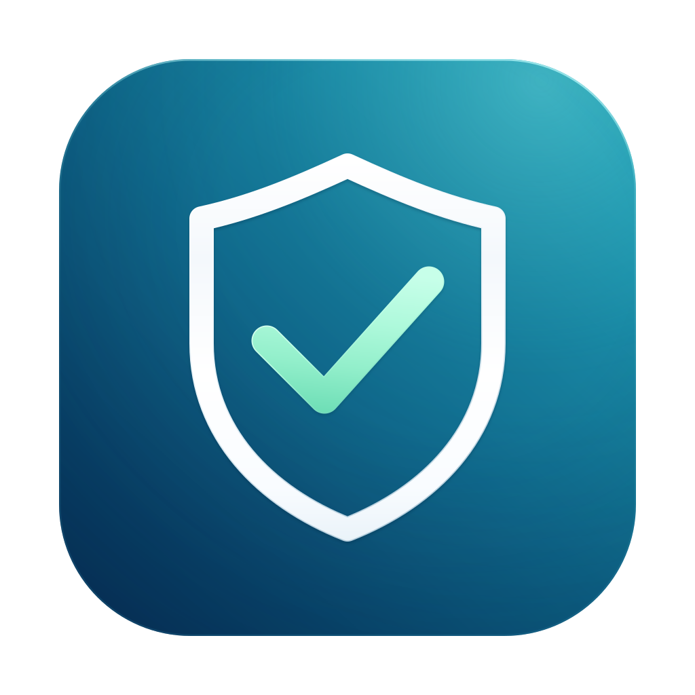
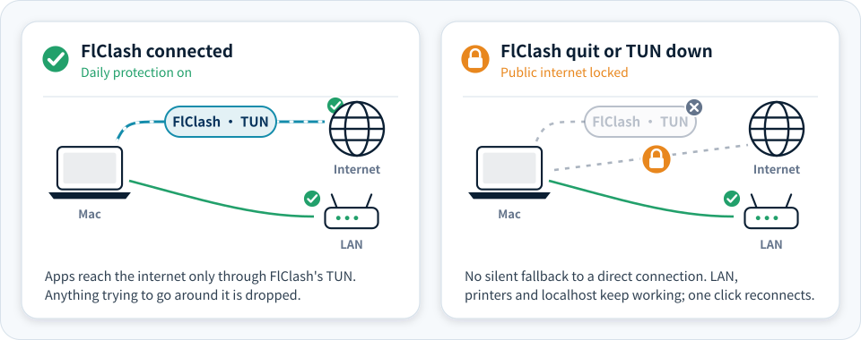
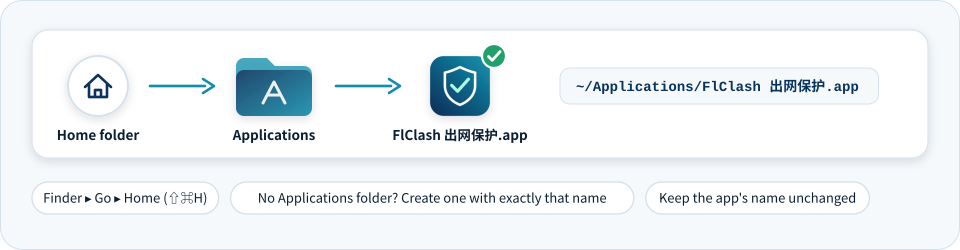
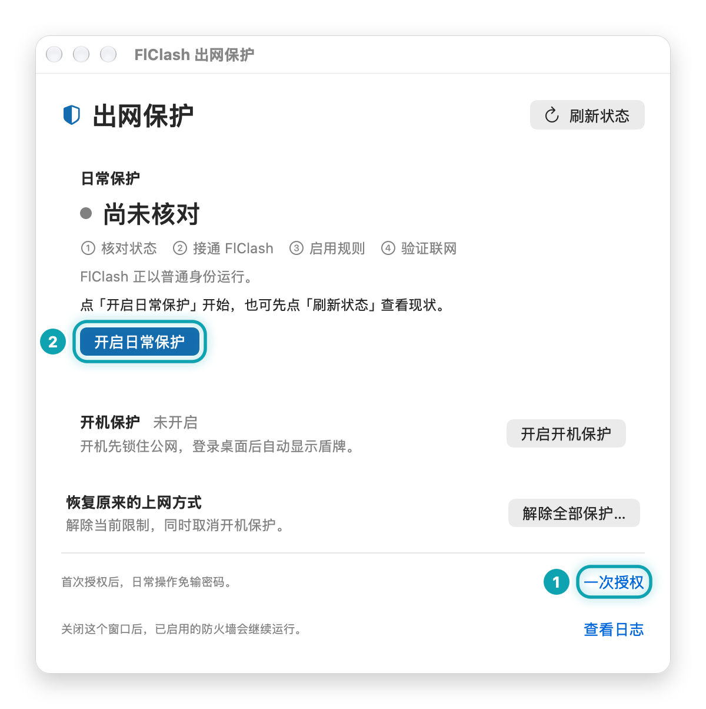
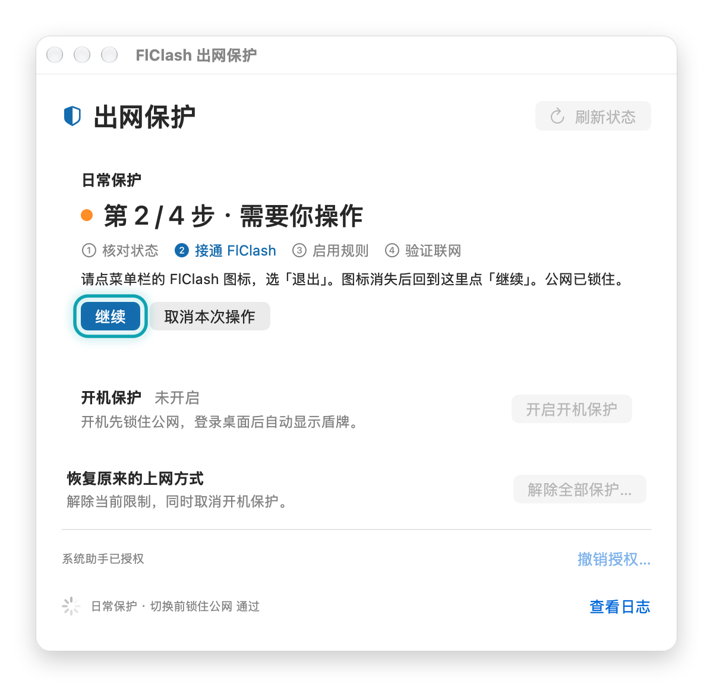
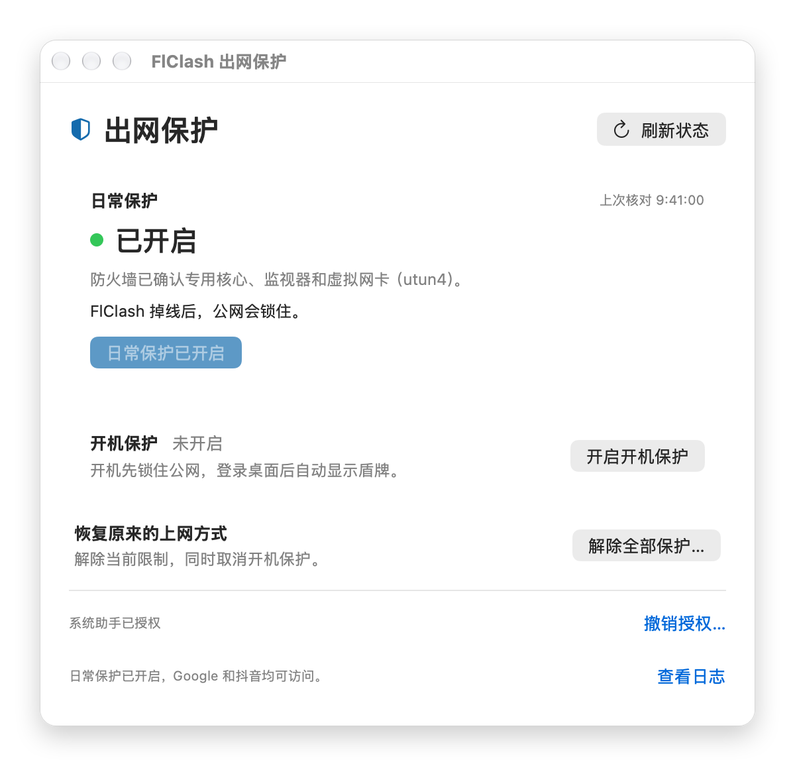
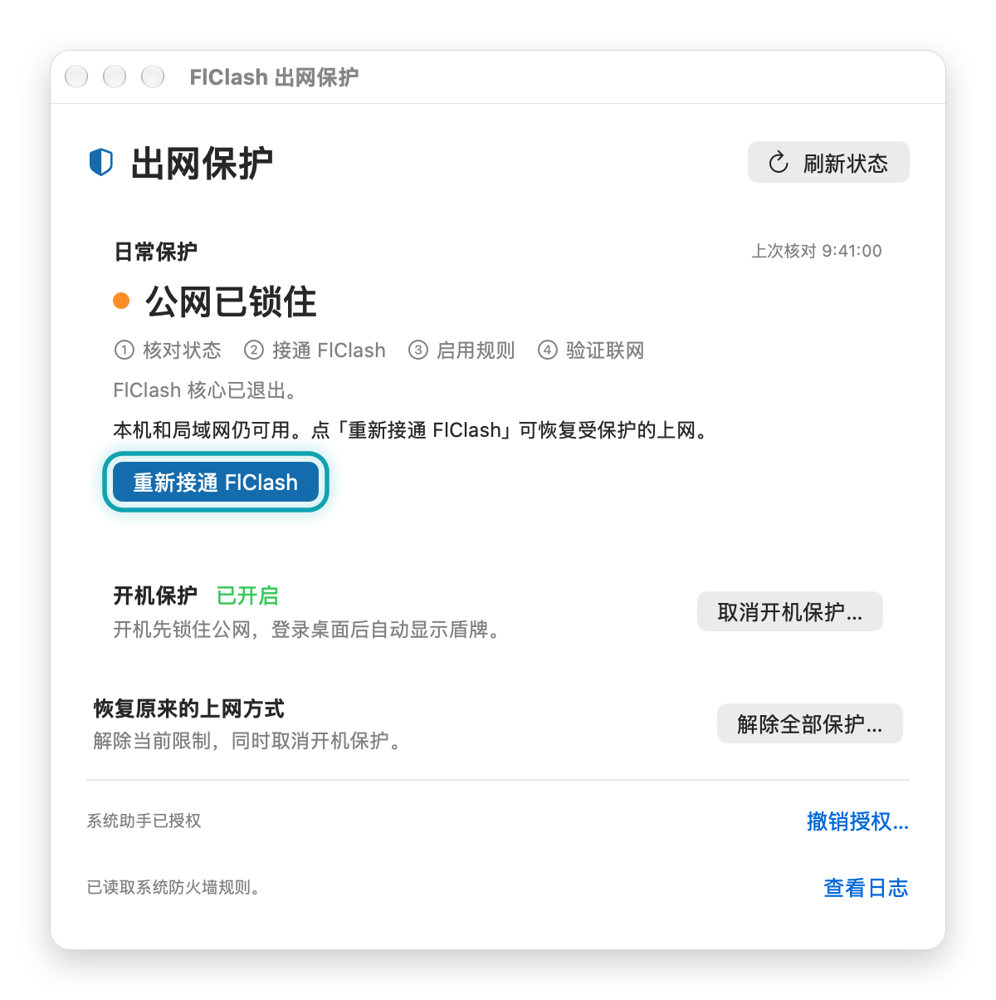
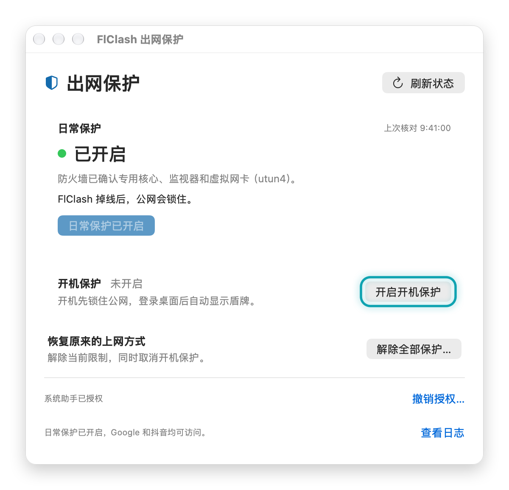
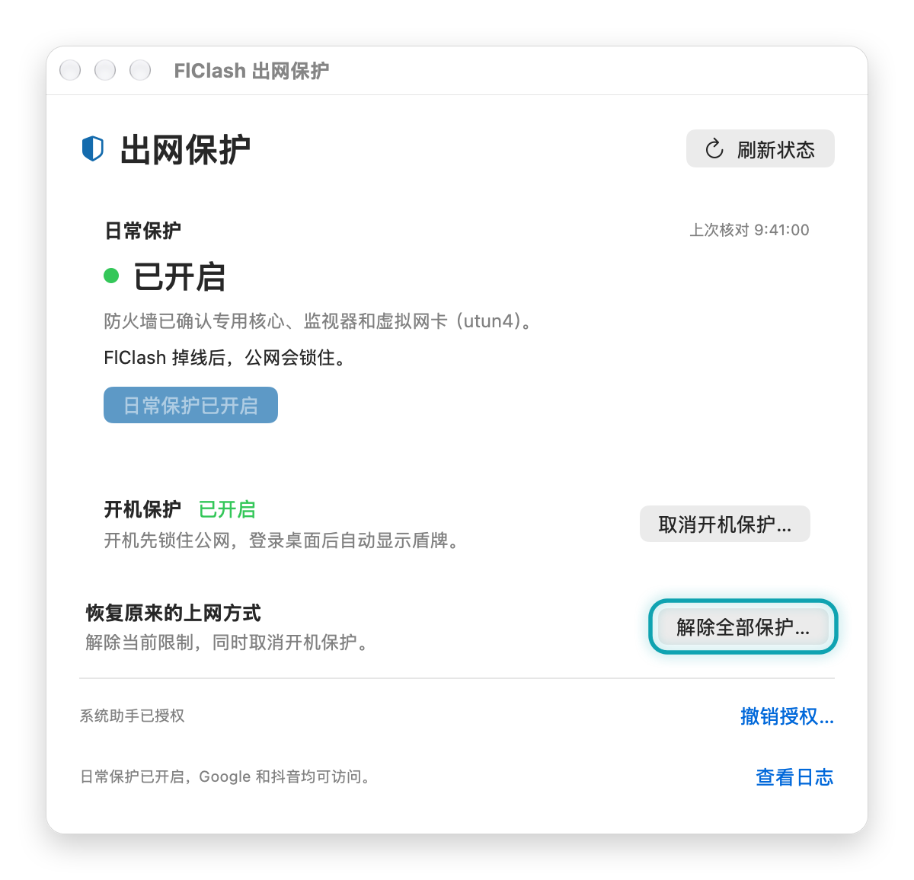

<p align="center">
  
</p>

<h1 align="center">FlClash Egress Guard</h1>

<p align="center">
  <b>A menu-bar kill switch for <a href="https://github.com/chen08209/FlClash">FlClash</a> on macOS.</b><br>
  When FlClash or its TUN drops, your Mac's internet locks instead of quietly going direct. Your LAN keeps working.
</p>

<p align="center">
  <a href="LICENSE"></a>
  <a href="#system-requirements"></a>
  <a href="#system-requirements"></a>
  <a href="CHANGELOG.md"></a>
  <a href="https://github.com/chen08209/FlClash"></a>
</p>

<p align="center"><b>English</b> · <a href="README.zh-CN.md">简体中文</a></p>

<p align="center">
  
</p>

> [!NOTE]
> The app's interface is in Simplified Chinese. Every button in this guide is shown with an English translation, for example **开启日常保护** (*Turn on daily protection*).

## Contents

- [What it does](#what-it-does)
- [Quick start](#quick-start): download, install, two clicks
- [Everyday use](#everyday-use)
- [Typical scenarios](#typical-scenarios)
- [System requirements](#system-requirements) · [Settings](#settings) · [Uninstall](#uninstall)
- [FAQ](#faq) · [Troubleshooting](#troubleshooting) · [Security and privacy](#security-and-privacy)
- [Roadmap](#roadmap) · [Feedback](#feedback) · [Acknowledgements](#acknowledgements) · [License](#license)

## What it does

With FlClash's TUN mode on, your Mac's traffic goes through FlClash. But if FlClash quits, crashes, restarts for an update or loses its TUN, macOS silently switches back to a direct connection. Your apps keep working, just not through FlClash, and nothing tells you.

FlClash Egress Guard stops that from happening:

- **Locks the internet the moment FlClash drops.** Your Mac goes offline within about a second, instead of going direct.
- **Nothing gets around FlClash.** While connected, apps can only go online through FlClash. That includes background services and command-line tools that ignore proxy settings.
- **Your local network keeps working.** Printers, NAS, AirPlay, your router and `localhost` stay reachable even while the internet is locked.
- **One click to get back online:** **重新接通 FlClash** (*Reconnect FlClash*).
- **Optional boot protection.** Every session starts locked, until you connect FlClash.
- **Simple and private.** Your password is needed only once. FlClash's subscriptions, rules and DNS are left untouched. There's no telemetry, and one button undoes everything.

It works with the firewall built into macOS, so there's nothing else to install.

<p align="center">
  
</p>

## Quick start

About five minutes. The app does the technical part; you click two buttons.

### Before you start

- [ ] **An Apple silicon Mac** (M1 or newer) **with macOS 13 Ventura or later.** Check under Apple menu › About This Mac.
- [ ] **FlClash in the main Applications folder** (`/Applications/FlClash.app`), with **TUN** turned on and working. In FlClash's Chinese interface this switch is called **虚拟网卡**.
- [ ] **Your Mac's administrator password.**
- [ ] **Command Line Tools for Xcode.** If they're missing, macOS offers to install them the first time the app needs them; click **Install**.
- [ ] **No other VPN or firewall app running**, and **Internet Sharing turned off**.

### Step 1: Download

Download **[FlClash-Egress-Guard-macOS-arm64.zip][download]** from the [latest release][releases], then double-click it in your Downloads folder to unzip it. You get an app called **FlClash 出网保护**.

<p align="center"></p>

### Step 2: Move it into your personal Applications folder

Put the app in the **Applications folder inside your home folder** (`~/Applications`), not the main one, and **keep its name unchanged**. Boot protection looks for it there.

1. In Finder choose **Go › Home** (⇧⌘H).
2. Open the **Applications** folder there. If there isn't one, create a folder named exactly `Applications`.
3. Drag **FlClash 出网保护** into it.

<p align="center"></p>

### Step 3: Open it the first time

The app is signed locally but **not notarized by Apple**, so macOS asks you to confirm the first launch:

1. Double-click the app. macOS says it can't verify it; click **Done**.
2. Open **System Settings › Privacy & Security**, scroll down to **Security**, and click **Open Anyway** next to *FlClash 出网保护*.
3. Enter your Mac password, then click **Open**.

On macOS 13 or 14 you can instead Control-click the app and choose **Open**, then **Open** again. You only do this once.

<p align="center"></p>

### Step 4: Authorize once (①)

The **出网保护** (*Egress protection*) window opens. At the bottom right, click **一次授权** (*Authorize once*) and enter your Mac password in the macOS dialog. The footer changes to **系统助手已授权** (*System helper authorized*). From now on, turning protection on and off won't ask for your password.

<p align="center"></p>

### Step 5: Turn on daily protection (②)

Click **开启日常保护** (*Turn on daily protection*). If you skipped step 4, the app asks for authorization first and then carries on.

The panel shows four steps as it checks everything. If it says **需要你操作** (*Your action needed*), do what it asks, then click **继续** (*Continue*):

| The panel asks… | What to do |
| --- | --- |
| 请点菜单栏的 FlClash 图标，选「退出」…<br>*Quit FlClash from its menu-bar icon* | Click FlClash's menu-bar icon and choose **退出** (*Exit*). When the icon disappears, click **继续**. The app reopens FlClash in protected mode. |
| 请打开 FlClash，确认「虚拟网卡（TUN）」开关已开启…<br>*Make sure TUN is on in FlClash* | Open FlClash, turn on **虚拟网卡** (*TUN*), then click **继续**. |

<p align="center"></p>

### Step 6: Done

When the panel shows **已开启** (*On*) with a green dot, you're protected. The app has checked the firewall and loaded Google and Douyin through FlClash. Close the window whenever you like: protection keeps running and the shield stays in the menu bar.

<p align="center"></p>

> [!TIP]
> Want the Mac to *start* locked, too? Turn on [boot protection](#boot-protection-optional). It's one more click.

## Everyday use

### The menu-bar shield

Click the shield for a quick status. **打开面板** (*Open panel*) opens the full window, and the power button quits the menu-bar app. **Quitting the app doesn't turn protection off.**

<p align="center"></p>

| Icon | Panel shows | Meaning |
| :---: | --- | --- |
|  | **已开启** (*On*) | Protected. Apps go online only through FlClash. |
|  | **公网已锁住** (*Internet locked*) | FlClash quit or lost its TUN. The LAN still works. Click **重新接通 FlClash** to go back online. |
|  | **未开启** (*Off*) | Protection is off. Apps use the network normally. |
|  | **尚未核对** / **需要复核** (*Not checked* / *Re-check*) | Something changed, for example FlClash just started or quit. Click the shield to check. |

### When it says 公网已锁住 (Internet locked)

That's the kill switch doing its job. Click the shield, then **打开面板**, then **重新接通 FlClash**. The app reopens FlClash in protected mode and you're back online.

<p align="center"></p>

### Boot protection (optional)

Without it, protection lasts until you restart. With it, your Mac starts with the internet locked, and the shield appears in the menu bar after you log in; open it and click **重新接通 FlClash**.

Click **开启开机保护** (*Turn on boot protection*). To stop it later, click **取消开机保护…**; this only affects future restarts. If it ever shows **登录启动待补全**, click **补全登录启动** (*Complete login launch*).

<p align="center"></p>

> [!TIP]
> If FlClash is set to **自启动** (*Auto launch*), you'll be asked to quit it once at every login. With boot protection on, you may prefer to switch FlClash's auto launch off and let this app open FlClash for you.

### After a restart

- **Boot protection on:** click the shield, then **打开面板** and **重新接通 FlClash**.
- **Boot protection off:** open **FlClash 出网保护** from `~/Applications` and click **开启日常保护** again.

### Back to normal internet

**解除全部保护…** (*Remove all protection…*) turns protection off and restores your original setup. If FlClash is still running, quit it and click the button once more to finish cleaning up.

<p align="center"></p>

### Updating the app

Quit the menu-bar app (protection keeps running), replace `~/Applications/FlClash 出网保护.app` with the new version and open it. Click **一次授权** again when it asks; each version needs its own authorization.

**查看日志** (*View log*) shows a simple history of checks: time, check name, pass or fail.

## Typical scenarios

- **Everyday proxy use without silent leaks.** FlClash crashes, an update restarts it, or you quit it by mistake: your Mac goes offline instead of going direct.
- **Every session starts locked.** With boot protection, apps that start at login (cloud sync, chat, browsers restoring tabs) can't get online before FlClash is connected.
- **Keep command-line tools and background services on the proxy.** Scripts, package managers, AI coding agents and system services can only get out through FlClash.
- **Home or office LAN while locked.** Printing, NAS, AirPlay, SSH to a Raspberry Pi and local dev servers keep working.
- **Wi-Fi with a login page** (hotels, airports). While the internet is locked, the login page can't load. Click **解除全部保护…**, log in, then turn protection back on.

## System requirements

| | |
| --- | --- |
| Mac | Apple silicon (M1 or newer). |
| macOS | 13 Ventura or later. |
| FlClash | Installed at `/Applications/FlClash.app`, with TUN (虚拟网卡) working. |
| Other | An administrator account. Command Line Tools for Xcode. No other VPN or firewall app active; Internet Sharing off. |

## Settings

There's no settings file; everything is a button in the app.

| Button | What it does |
| --- | --- |
| **一次授权** / **撤销授权…** (*Authorize once* / *Revoke authorization…*) | Lets the app manage protection without asking for your password, or takes that permission back. Protection itself is unaffected. |
| **开启日常保护** / **重新接通 FlClash** (*Turn on daily protection* / *Reconnect FlClash*) | Turns protection on and connects FlClash. Lasts until you restart or remove protection. |
| **开启开机保护** / **取消开机保护…** (*Turn boot protection on / off*) | Starts every session with the internet locked. |
| **解除全部保护…** (*Remove all protection…*) | Restores your original setup. |
| **刷新状态** (*Refresh*) · **查看日志** (*View log*) | Re-checks the status · opens the log. |

In FlClash, just keep **虚拟网卡** (*TUN*) on. Its rules, subscriptions, proxy groups and DNS are yours to change as usual.

## Uninstall

1. In the app, click **解除全部保护…** and confirm. If FlClash was running, quit it and click the button once more.
2. Click **撤销授权…** (*Revoke authorization…*).
3. Quit the menu-bar app (shield › power button) and move **FlClash 出网保护** to the Trash.
4. Optional: delete `~/Library/Logs/FlClashEgressGuard` and `~/Library/Preferences/local.flclash.egressguard.control.plist`.

From now on, open FlClash the usual way.

<details>
<summary><b>If the app won't open</b>, use Terminal</summary>

```sh
sudo "$HOME/Applications/FlClash 出网保护.app/Contents/Resources/egress-guard" rollback
sudo "$HOME/Applications/FlClash 出网保护.app/Contents/Resources/guard-authorize" remove "$(id -u)"
```

The first command removes the protection, the second removes the authorization. If the first says FlClash is still in use, quit FlClash and run it again.

</details>

## FAQ

<details>
<summary><b>Does it change my FlClash settings?</b></summary>

No. Subscriptions, rules, overrides, proxy groups and DNS stay exactly as they are.
</details>

<details>
<summary><b>Does it work with other clients or VPNs (Clash Verge, ClashX, Surge…)?</b></summary>

No. It's made for FlClash. Other VPNs generally won't work while protection is on.
</details>

<details>
<summary><b>Do I need to keep the app open?</b></summary>

No. Protection keeps running after you close the window or quit the app.
</details>

<details>
<summary><b>I quit FlClash on purpose. Why is my internet gone?</b></summary>

That's the kill switch. Click **重新接通 FlClash** to go back online through FlClash, or **解除全部保护…** to use the internet without it.
</details>

<details>
<summary><b>Will my printer, NAS, AirPlay or local servers keep working?</b></summary>

Yes, as long as they're on your local network. Addresses in `100.64.0.0/10` (used by Tailscale, for example) don't count as local.
</details>

<details>
<summary><b>Does protection survive a restart?</b></summary>

Daily protection doesn't, so click **开启日常保护** again after restarting. Turn on boot protection if you want every session to start locked.
</details>

<details>
<summary><b>Why Google and Douyin?</b></summary>

They're the final check that the connection really works. If one can't load on your network, step 4 shows **未完成** (*not finished*), but protection is still on.
</details>

<details>
<summary><b>Does it work on Intel Macs?</b></summary>

No. The release is for Apple silicon only.
</details>

<details>
<summary><b>macOS said "Background Items Added". Is that normal?</b></summary>

Yes. The authorization and boot protection each add a background item. Please manage them with the app's buttons, not in System Settings.
</details>

## Troubleshooting

The panel shows what went wrong. The most common messages:

| Message | What to do |
| --- | --- |
| 需要一个正在运行的 FlClash 及其核心。 | Open FlClash, then click **重试** (*Retry*). |
| FlClash 正在运行。切换启动身份需要你先手动退出。 | Quit FlClash from its menu-bar icon, then click **继续**. |
| 核心没有可确认归属的唯一 TUN。 / 核心的 TUN 未启用。 | Turn on **虚拟网卡** (*TUN*) in FlClash, wait a moment, then retry. |
| 当前核心的父进程或身份不符合预期。 | Make sure TUN works in FlClash on its own, then retry. |
| …没有返回网页。请检查 FlClash 里选用的节点，再点「重试」。 | Protection is on, but a test site didn't load. Check your FlClash node, then retry. |
| 发现其他活动过滤规则… / 发现其他活动的地址转换… | Another VPN or firewall, or Internet Sharing, is active. Turn it off and retry. |
| 未能连接系统助手。请点「一次授权」重新登记。 | Click **一次授权** again (common after updating the app). |

**macOS won't open the app.** Follow [step 3](#step-3-open-it-the-first-time).

**macOS asks to install "command line developer tools".** Click **Install**, wait until it finishes, and open the app again.

**I need the internet back right now.** Click **解除全部保护…**. If the app won't open, use the Terminal commands under [Uninstall](#uninstall).

**Still stuck?** [Open an issue][issues] with your macOS version, the panel's message and the relevant log lines. Remove anything personal first: node addresses, subscription links, IP addresses, user names.

## Security and privacy

- Your password is only ever typed into macOS's own dialog; the app never sees it.
- The app never changes or removes other apps' firewall settings. If something is in the way, it stops and tells you.
- No telemetry. The only connections the app makes itself are its checks to Google, Douyin and `1.1.1.1`.
- The log holds only times, check names and pass/fail. No addresses.
- It's a safety net, not antivirus: software that already has administrator rights could still change the firewall.
- Download only from the official release page, and compare the SHA-256 shown there: `shasum -a 256 ~/Downloads/FlClash-Egress-Guard-macOS-arm64.zip`.

Found a security problem? Please report it privately; see [SECURITY.md](SECURITY.md).

## Roadmap

Ideas, not promises:

- English interface.
- Notarized releases, so the first launch needs no extra steps.
- Intel Mac support.
- Choosing your own test sites.
- FlClash installed outside `/Applications`.

## Feedback

The app's source code isn't public, but feedback is very welcome: [report a bug or suggest a feature][issues] (see [CONTRIBUTING.md](CONTRIBUTING.md)). Please follow the [Code of Conduct](CODE_OF_CONDUCT.md).

## Acknowledgements

- [FlClash](https://github.com/chen08209/FlClash) by chen08209, the client this app works with.
- [mihomo](https://github.com/MetaCubeX/mihomo) (Clash.Meta), FlClash's core.
- [Shields.io](https://shields.io) for the badges.

FlClash Egress Guard is an independent project, not affiliated with or endorsed by FlClash.

## License

Free to download and use. © 2026 madgiraffe1. See [LICENSE](LICENSE).

[download]: https://github.com/madgiraffe1/flclash-egress-guard/releases/latest/download/FlClash-Egress-Guard-macOS-arm64.zip
[releases]: https://github.com/madgiraffe1/flclash-egress-guard/releases/latest
[issues]: https://github.com/madgiraffe1/flclash-egress-guard/issues/new/choose
