<p align="center">
  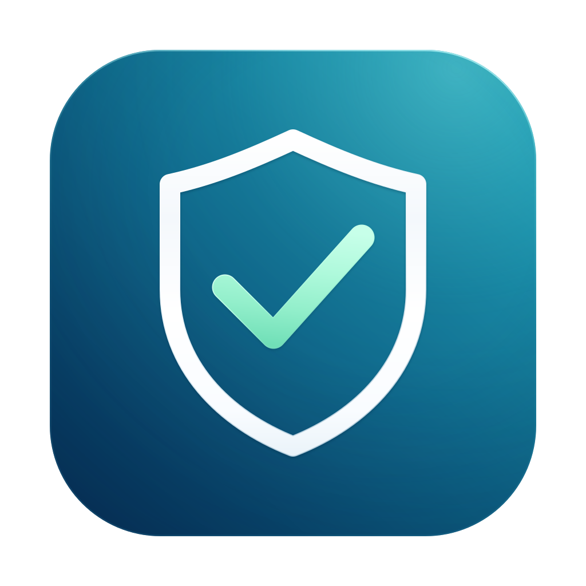
</p>

<h1 align="center">FlClash 出网保护</h1>

<p align="center">
  <b>macOS 菜单栏里的 <a href="https://github.com/chen08209/FlClash">FlClash</a> 断网保护。</b><br>
  FlClash 或虚拟网卡掉线时，Mac 不会悄悄改成直连，而是锁住公网；局域网照常可用。
</p>

<p align="center">
  <a href="LICENSE"></a>
  <a href="#系统要求"></a>
  <a href="#系统要求"></a>
  <a href="CHANGELOG.md"></a>
  <a href="https://github.com/chen08209/FlClash"></a>
</p>

<p align="center"><a href="README.md">English</a> · <b>简体中文</b></p>

<p align="center">
  
</p>

## 目录

- [它能做什么](#它能做什么)
- [快速上手](#快速上手)：下载、安装、点两下
- [日常使用](#日常使用)
- [典型场景](#典型场景)
- [系统要求](#系统要求) · [设置说明](#设置说明) · [卸载](#卸载)
- [常见问题](#常见问题) · [故障排查](#故障排查) · [安全与隐私](#安全与隐私)
- [路线图](#路线图) · [反馈](#反馈) · [致谢](#致谢) · [许可](#许可)

## 它能做什么

FlClash 开启虚拟网卡（TUN）后，Mac 的流量都经过 FlClash。可一旦 FlClash 退出、崩溃、更新重启，或者虚拟网卡掉了，macOS 会悄悄改回直连：应用照常能上网，只是不再经过 FlClash，而且没有任何提示。

FlClash 出网保护就是为了防止这种情况：

- **FlClash 一掉线就锁住公网。** 约一秒内断开公网，而不是改成直连。
- **谁也绕不开 FlClash。** 联网时，应用只能经 FlClash 上网，不理会代理设置的后台服务和命令行工具也一样。
- **局域网照常可用。** 公网锁住时，打印机、NAS、AirPlay、路由器和 `localhost` 都不受影响。
- **一键恢复上网：** 点 **重新接通 FlClash** 即可。
- **可选的开机保护。** 每次开机都先锁住，直到你接通 FlClash。
- **简单、不碰隐私。** 只需输入一次密码；不改 FlClash 的订阅、规则和 DNS；没有遥测；一个按钮就能全部撤销。

它使用 macOS 自带的防火墙，不需要额外安装任何东西。

<p align="center">
  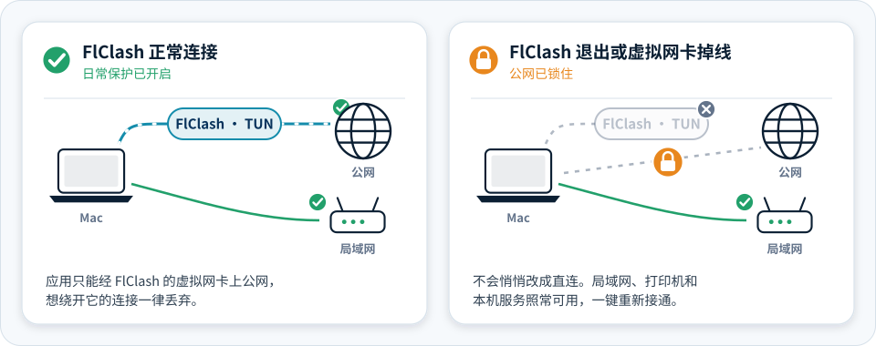
</p>

<p align="center">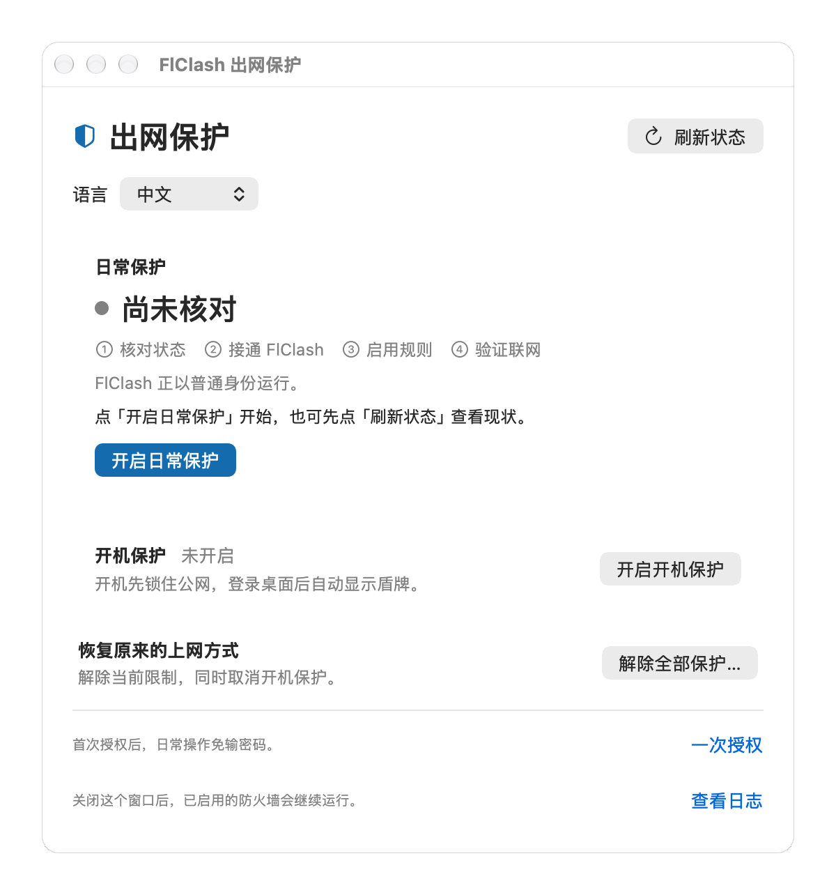</p>

*截图和动图由 App 的真实界面视图配合示例状态渲染，不代表执行了真实网络切换。*

## 快速上手

大约五分钟。技术活交给 App，你只需要点两个按钮。

### 开始前请确认

- [ ] **Apple 芯片的 Mac**（M1 及更新），**macOS 13 Ventura 或更新**。可在苹果菜单 ›「关于本机」查看。
- [ ] **FlClash 装在系统的「应用程序」文件夹**（`/Applications/FlClash.app`），并且 **虚拟网卡** 已开启、能正常使用。
- [ ] **知道这台 Mac 的管理员密码。**
- [ ] **Xcode 命令行工具。** 如果没装，App 第一次用到时 macOS 会提示安装，点「安装」即可。
- [ ] **没有运行其他 VPN 或防火墙软件**，并且 **「互联网共享」已关闭**。

### 第 1 步：下载

从[最新发布][releases]下载 **[FlClash-Egress-Guard-macOS-arm64.zip][download]**，在「下载」文件夹里双击解压，得到 **FlClash 出网保护** 这个 App。

<p align="center">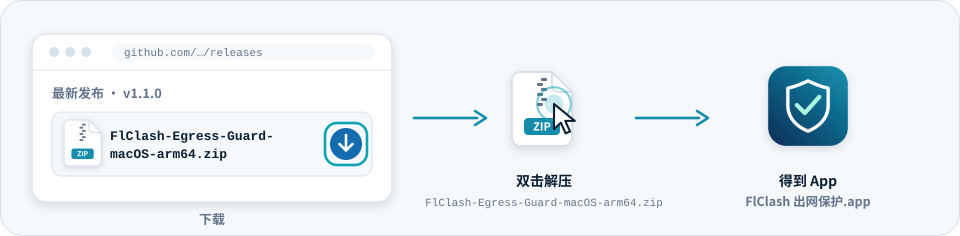</p>

### 第 2 步：放进个人的「应用程序」文件夹

把 App 放进**个人文件夹里的「应用程序」**（`~/Applications`），不是系统的那个，并且**不要改名**。开机保护会到这里找它。

1. 在访达里选「前往 › 个人」（⇧⌘H）。
2. 打开里面的「应用程序」文件夹。如果没有，就新建一个文件夹，名字写 `Applications`。
3. 把 **FlClash 出网保护** 拖进去。

<p align="center">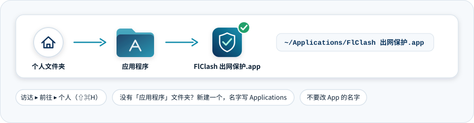</p>

### 第 3 步：第一次打开

App 采用本机签名，**没有经过 Apple 公证**，所以第一次打开时 macOS 要你确认：

1. 双击 App，系统提示无法验证，先点「完成」。
2. 打开「系统设置 › 隐私与安全性」，滚动到「安全性」，在 *FlClash 出网保护* 旁边点「仍要打开」。
3. 输入 Mac 登录密码，再点「打开」。

macOS 13 或 14 也可以：按住 Control 点按 App，选「打开」，再点「打开」。这一步只需做一次。

<p align="center">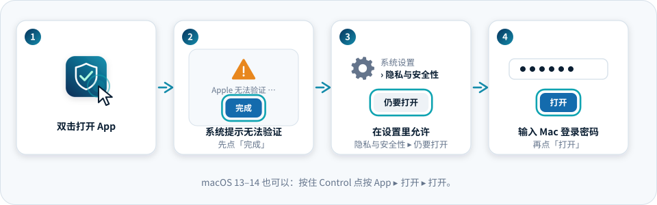</p>

### 第 4 步：一次授权（①）

App 打开后显示「出网保护」窗口。点右下角的 **一次授权**，在 macOS 弹出的窗口里输入 Mac 密码，底部会变成 **系统助手已授权**。以后开关保护都不用再输密码。

<p align="center">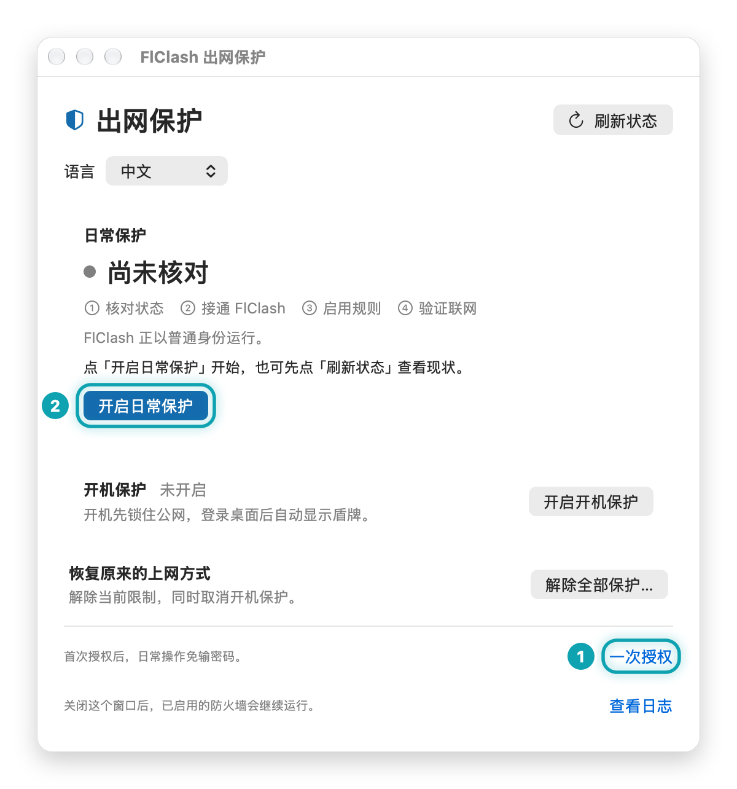</p>

### 第 5 步：开启日常保护（②）

点 **开启日常保护**。如果跳过了第 4 步，App 会先请你授权，再继续。

面板会按四步逐项检查。出现 **需要你操作** 时，照提示做完再点 **继续**：

| 面板提示 | 怎么做 |
| --- | --- |
| 请点菜单栏的 FlClash 图标，选「退出」… | 点菜单栏的 FlClash 图标选「退出」，等图标消失后点 **继续**。App 会以受保护的方式重新打开 FlClash。 |
| 请打开 FlClash，确认「虚拟网卡（TUN）」开关已开启… | 打开 FlClash，打开 **虚拟网卡** 开关，再点 **继续**。 |

<p align="center">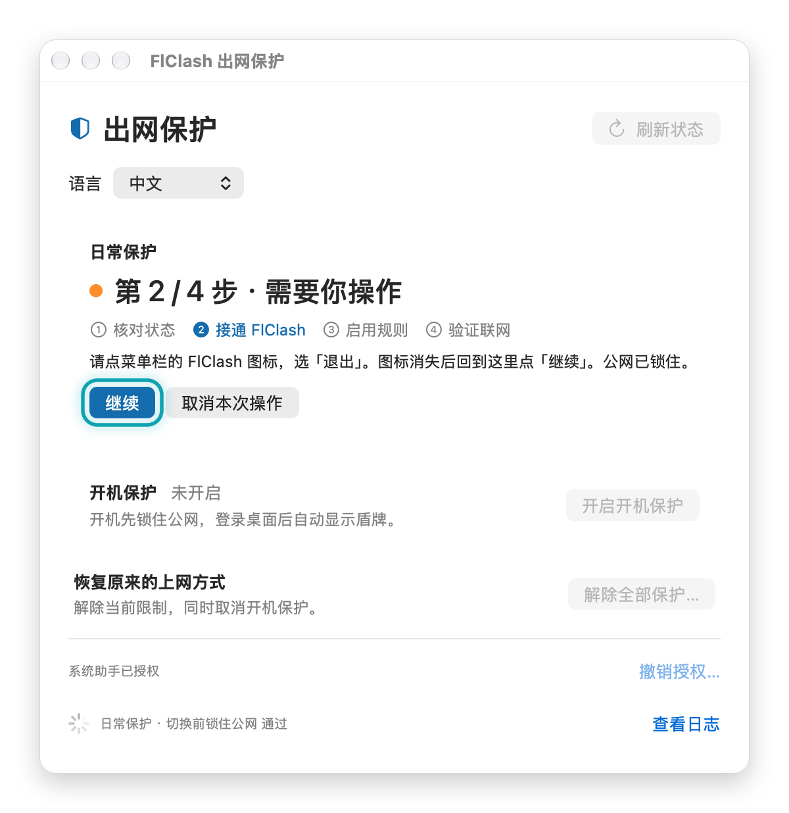</p>

### 第 6 步：完成

面板显示绿色的 **已开启**，就说明保护生效了：App 已核对过防火墙，并经 FlClash 打开了 Google 和抖音。窗口随时可以关掉，保护继续运行，盾牌留在菜单栏。

<p align="center">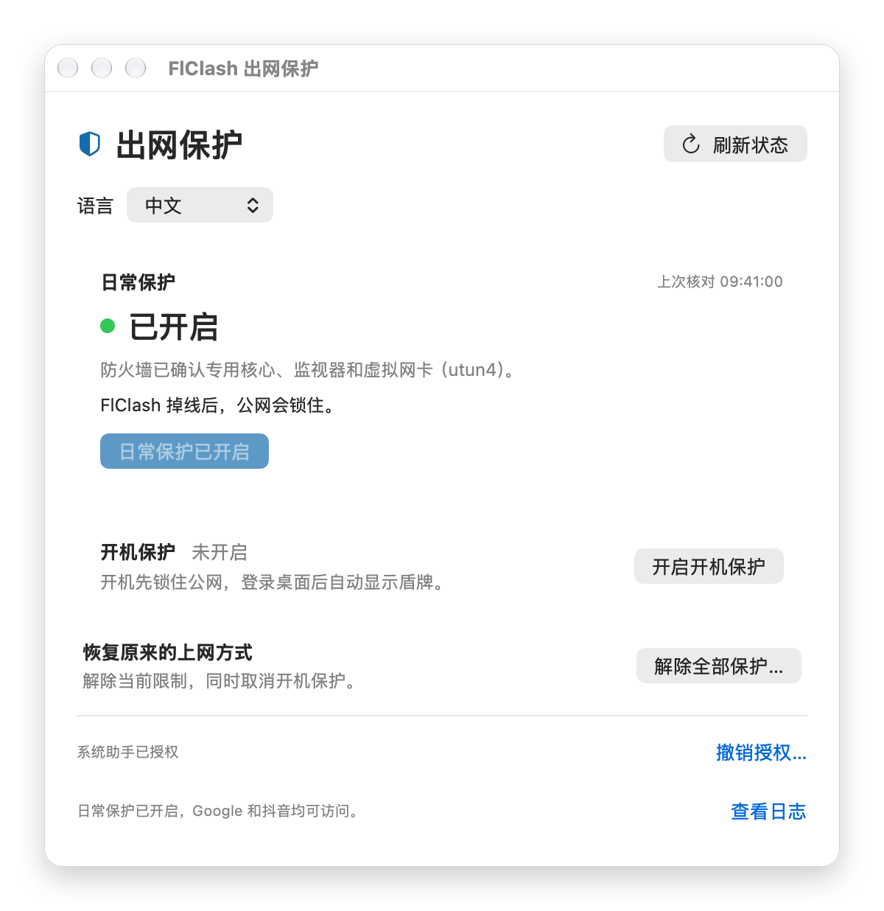</p>

> [!TIP]
> 想让 Mac 一开机就锁住？再点一下，打开[开机保护](#开机保护可选)。

## 日常使用

### 菜单栏盾牌

点菜单栏的盾牌可以快速查看状态。**打开面板** 打开完整窗口，电源按钮退出菜单栏 App。**退出 App 不会关闭保护。**

<p align="center"></p>

| 图标 | 面板显示 | 含义 |
| :---: | --- | --- |
|  | **已开启** | 受保护中，应用只能经 FlClash 上网。 |
|  | **公网已锁住** | FlClash 退出了或虚拟网卡掉了，局域网仍可用。点 **重新接通 FlClash** 恢复上网。 |
|  | **未开启** | 保护未开启，应用按原来的方式上网。 |
|  | **尚未核对** / **需要复核** | 情况有变化（比如 FlClash 刚打开或刚退出），点盾牌重新核对。 |

### 提示「公网已锁住」时

这说明断网保护正在起作用。点盾牌 › **打开面板** › **重新接通 FlClash**，App 会以受保护的方式重新打开 FlClash，恢复上网。

<p align="center">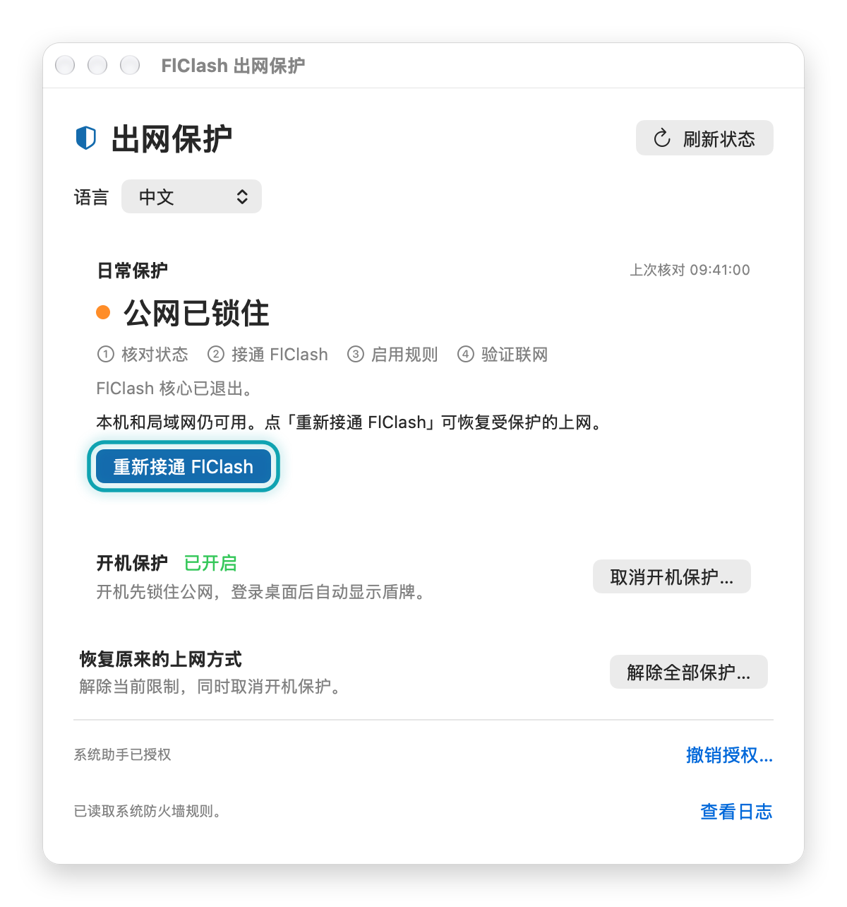</p>

### 开机保护（可选）

不开时，保护只到重启为止。开启后，Mac 开机就锁住公网，登录后菜单栏自动出现盾牌，打开它点 **重新接通 FlClash** 即可。

点 **开启开机保护** 开启。以后要取消，点 **取消开机保护…**，只影响以后的开机。如果显示 **登录启动待补全**，点 **补全登录启动**。

<p align="center">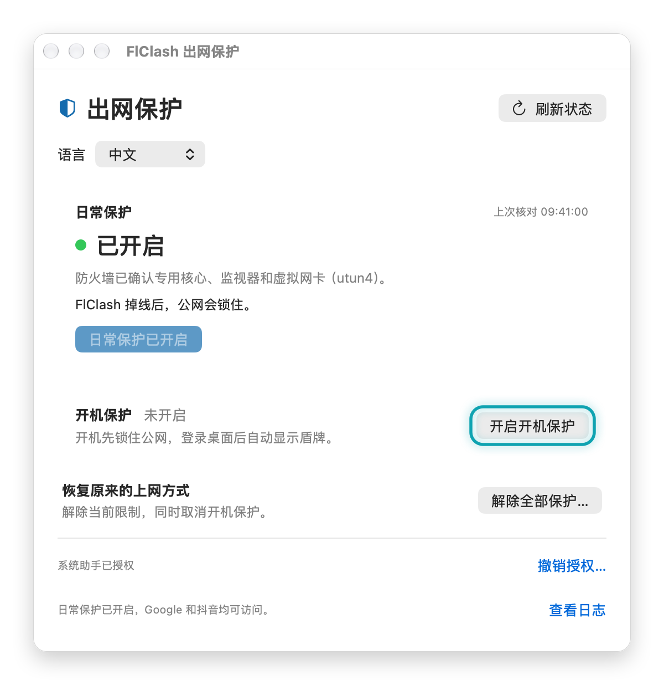</p>

> [!TIP]
> 如果 FlClash 设置了 **自启动**，每次登录都会请你先退出一次 FlClash。开了开机保护的话，可以关掉 FlClash 的自启动，让本 App 来打开它。

### 重启之后

- **开了开机保护：** 点盾牌 › **打开面板** › **重新接通 FlClash**。
- **没开开机保护：** 从 `~/Applications` 打开 **FlClash 出网保护**，再点一次 **开启日常保护**。

### 恢复原来的上网方式

**解除全部保护…** 会关闭保护，让网络回到原来的样子。如果 FlClash 还开着，退出它之后再点一次这个按钮，完成清理。

<p align="center">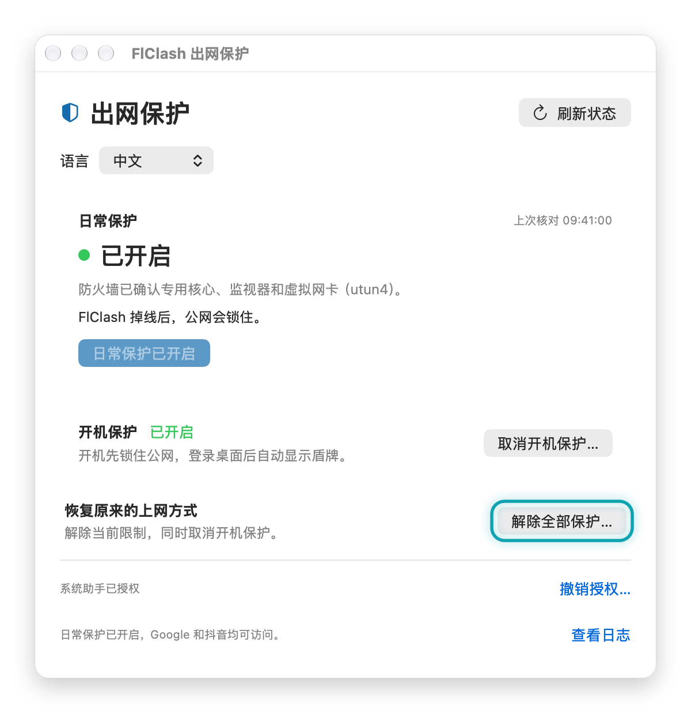</p>

### 更新 App

退出菜单栏 App（保护会继续运行），用新版替换 `~/Applications/FlClash 出网保护.app` 后打开。提示授权时再点一次 **一次授权**，每个版本都需要单独授权。

**查看日志** 可以看到简单的检查记录：时间、检查项、通过或不通过。

## 典型场景

- **日常用代理，不怕悄悄泄漏。** FlClash 崩溃、更新重启或被误关时，Mac 会断开公网，而不是改成直连。
- **每次开机都先锁住。** 开了开机保护，登录时自动启动的应用（网盘同步、聊天软件、恢复标签页的浏览器）在 FlClash 接通前都上不了网。
- **让命令行工具和后台服务也走代理。** 脚本、包管理器、AI 编程助手和系统服务都只能经 FlClash 出网。
- **锁定时照常用局域网。** 打印、NAS、AirPlay、SSH 到树莓派、本地开发服务都不受影响。
- **需要网页登录的 Wi-Fi**（酒店、机场）。公网锁住时登录页打不开。先点 **解除全部保护…**，登录后再重新开启保护。

## 系统要求

| | |
| --- | --- |
| Mac | Apple 芯片（M1 及更新）。 |
| macOS | 13 Ventura 或更新。 |
| FlClash | 装在 `/Applications/FlClash.app`，虚拟网卡能正常使用。 |
| 其他 | 管理员账户；Xcode 命令行工具；没有运行其他 VPN 或防火墙软件；「互联网共享」已关闭。 |

## 设置说明

在面板或菜单栏弹窗的 **语言** 菜单中，可选择 **跟随系统**、**中文** 或 **English**，切换立即生效并自动保存，不影响保护状态。默认跟随系统：系统语言为中文时显示中文，其他语言显示英文。

其余设置都是 App 里的按钮。

| 按钮 | 作用 |
| --- | --- |
| **一次授权** / **撤销授权…** | 让 App 管理保护时不再要密码，或收回这项授权。不影响保护本身。 |
| **开启日常保护** / **重新接通 FlClash** | 开启保护并接通 FlClash，持续到重启或解除保护为止。 |
| **开启开机保护** / **取消开机保护…** | 每次开机都先锁住公网。 |
| **解除全部保护…** | 恢复原来的上网方式。 |
| **刷新状态** · **查看日志** | 重新核对状态 · 打开日志。 |

FlClash 这边只要保持 **虚拟网卡** 开启即可；分流规则、订阅、代理组和 DNS 照常由你自己设置。

## 卸载

1. 在 App 里点 **解除全部保护…** 并确认。如果 FlClash 还开着，退出它后再点一次。
2. 点 **撤销授权…**。
3. 退出菜单栏 App（盾牌 › 电源按钮），把 **FlClash 出网保护** 移到废纸篓。
4. 可选：删除 `~/Library/Logs/FlClashEgressGuard` 和 `~/Library/Preferences/local.flclash.egressguard.control.plist`。

之后照常打开 FlClash 即可。

<details>
<summary><b>App 打不开时</b>，用终端卸载</summary>

```sh
sudo "$HOME/Applications/FlClash 出网保护.app/Contents/Resources/egress-guard" rollback
sudo "$HOME/Applications/FlClash 出网保护.app/Contents/Resources/guard-authorize" remove "$(id -u)"
```

第一条解除保护，第二条撤销授权。如果第一条提示 FlClash 仍在使用，退出 FlClash 后再运行一次。

</details>

## 常见问题

<details>
<summary><b>会改动我的 FlClash 设置吗？</b></summary>

不会。订阅、分流规则、覆写、代理组和 DNS 原封不动。
</details>

<details>
<summary><b>能配合其他客户端或 VPN 使用吗（Clash Verge、ClashX、Surge…）？</b></summary>

不能。它专为 FlClash 设计；保护开启时，其他 VPN 一般也无法工作。
</details>

<details>
<summary><b>App 需要一直开着吗？</b></summary>

不需要。关掉窗口或退出 App 后，保护照样运行。
</details>

<details>
<summary><b>我是故意退出 FlClash 的，怎么上不了网了？</b></summary>

这正是断网保护在起作用。点 **重新接通 FlClash** 经 FlClash 恢复上网；如果想不用 FlClash 上网，点 **解除全部保护…**。
</details>

<details>
<summary><b>打印机、NAS、AirPlay、本地服务还能用吗？</b></summary>

能，只要它们在你的局域网里。`100.64.0.0/10` 网段的地址（例如 Tailscale 使用的）不算局域网。
</details>

<details>
<summary><b>重启后保护还在吗？</b></summary>

日常保护不会保留，重启后再点一次 **开启日常保护**。想让每次开机都先锁住，就打开开机保护。
</details>

<details>
<summary><b>为什么检查 Google 和抖音？</b></summary>

这是确认网络真正可用的最后一步。如果你的网络打不开其中一个，第 4 步会显示 **未完成**，但保护仍然生效。
</details>

<details>
<summary><b>支持 Intel Mac 吗？</b></summary>

不支持，发布包只适用于 Apple 芯片。
</details>

<details>
<summary><b>macOS 提示「已添加后台项目」，正常吗？</b></summary>

正常。授权和开机保护各会添加一个后台项目。请用 App 里的按钮来开关，不要在系统设置里关掉它们。
</details>

## 故障排查

面板会显示出了什么问题。最常见的提示：

| 提示 | 怎么办 |
| --- | --- |
| 需要一个正在运行的 FlClash 及其核心。 | 打开 FlClash，再点 **重试**。 |
| FlClash 正在运行。切换启动身份需要你先手动退出。 | 从菜单栏图标退出 FlClash，再点 **继续**。 |
| 核心没有可确认归属的唯一 TUN。 / 核心的 TUN 未启用。 | 在 FlClash 里打开 **虚拟网卡**，稍等片刻再重试。 |
| 当前核心的父进程或身份不符合预期。 | 先确认 FlClash 自己的虚拟网卡能正常使用，再重试。 |
| …没有返回网页。请检查 FlClash 里选用的节点，再点「重试」。 | 保护已生效，但检查网站没打开。检查 FlClash 节点后重试。 |
| 发现其他活动过滤规则… / 发现其他活动的地址转换… | 有其他 VPN、防火墙或「互联网共享」在运行，关掉后重试。 |
| 未能连接系统助手。请点「一次授权」重新登记。 | 再点一次 **一次授权**（更新 App 后常见）。 |

**macOS 不让打开 App。** 按[第 3 步](#第-3-步第一次打开)操作。

**提示要安装「命令行开发者工具」。** 点「安装」，装完后重新打开 App。

**急需恢复上网。** 点 **解除全部保护…**；App 打不开时，用[卸载](#卸载)里的终端命令。

**还是解决不了？** 请[提交 issue][issues]，写明 macOS 版本、面板上的提示和相关日志。提交前请删掉个人信息：节点地址、订阅链接、IP 地址、用户名。

## 安全与隐私

- 密码只会输入到 macOS 自己的窗口里，App 看不到。
- 不会修改或清除其他软件的防火墙设置；遇到冲突就停下来告诉你。
- 没有遥测。App 自己发起的连接只有检查用的 Google、抖音和 `1.1.1.1`。
- 日志只记时间、检查项和通过/不通过，不含任何地址。
- 它是安全网，不是杀毒软件：已经拿到管理员权限的软件仍可以改动防火墙。
- 只从官方发布页下载，并核对页面上显示的 SHA-256：`shasum -a 256 ~/Downloads/FlClash-Egress-Guard-macOS-arm64.zip`。

发现安全问题？请私下报告，见 [SECURITY.md](SECURITY.md)。

## 路线图

以下是设想，不是承诺：

- 经 Apple 公证的发布包，第一次打开不再需要额外步骤。
- 支持 Intel Mac。
- 自定义检查网站。
- 支持装在 `/Applications` 以外的 FlClash。

## 反馈

源码已在本仓库公开，欢迎反馈和提交 PR：[报告问题或提出建议][issues]（见 [CONTRIBUTING.md](CONTRIBUTING.md)）。请遵守[行为准则](CODE_OF_CONDUCT.md)。

## 致谢

- [FlClash](https://github.com/chen08209/FlClash)（作者 chen08209）：本 App 配合使用的客户端。
- [mihomo](https://github.com/MetaCubeX/mihomo)（Clash.Meta）：FlClash 的核心。
- [Shields.io](https://shields.io)：徽章服务。

FlClash 出网保护是独立项目，与 FlClash 项目没有隶属关系，也未获其背书。

## 许可

免费下载使用。© 2026 madgiraffe1。详见 [LICENSE](LICENSE)。

[download]: https://github.com/madgiraffe1/flclash-egress-guard/releases/latest/download/FlClash-Egress-Guard-macOS-arm64.zip
[releases]: https://github.com/madgiraffe1/flclash-egress-guard/releases/latest
[issues]: https://github.com/madgiraffe1/flclash-egress-guard/issues/new/choose
