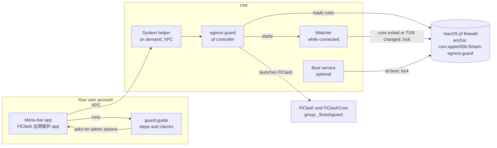
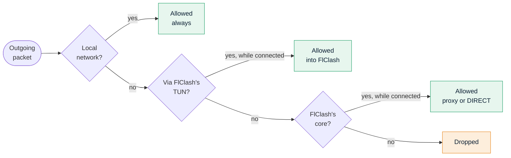
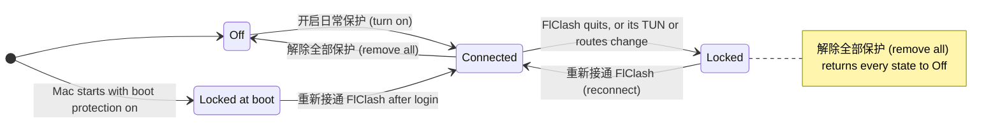
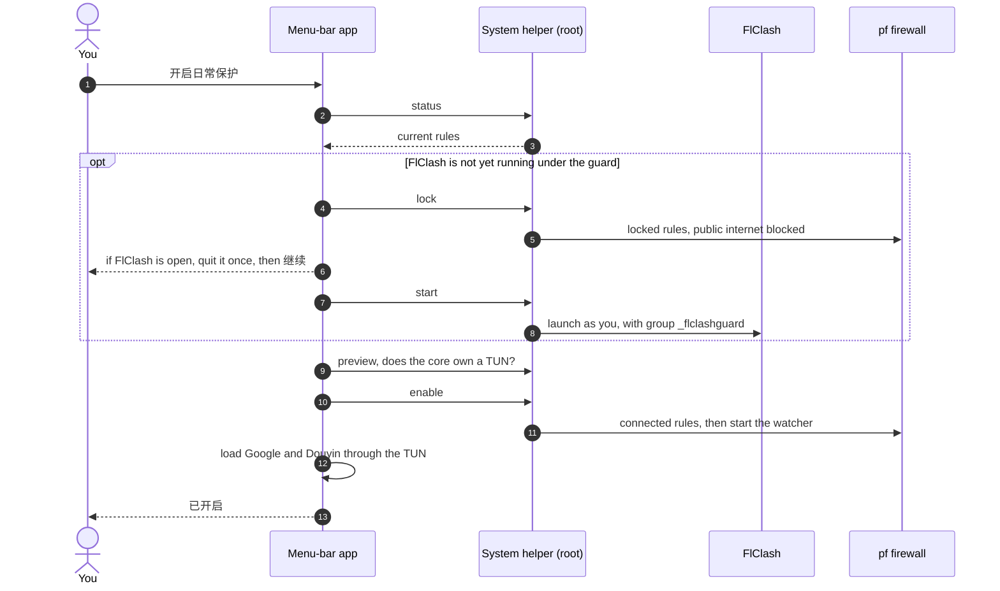

# Development notes (internal)

> [!IMPORTANT]
> Internal document for the **private source repository**. Don't copy it, `app/`, `outputs/` or `docs/tools/` to a public repository: the source code is not published. See [Releasing](#releasing) for what can go public.

## Contents

- [Repository layout](#repository-layout)
- [Building](#building)
- [Quick checks](#quick-checks)
- [Testing changes safely](#testing-changes-safely)
- [Code style](#code-style)
- [Updating the README images](#updating-the-readme-images)
- [Releasing](#releasing)
- [Technical reference](#technical-reference): how it works, built-in values, Finder scripts, command line, files and system changes

## Repository layout

```text
app/                      macOS menu-bar app (Swift/SwiftUI) and its privileged helper
  main.swift              menu-bar shield, panel and the step-by-step flow
  GuardService.swift      XPC protocol and signature checks shared by app and helper
  GuardHelper.swift       on-demand root helper: XPC → egress-guard
  guard-authorize         installs or removes the helper (run through the macOS admin dialog)
  Authorize.applescript   shows the macOS administrator dialog
  Icon.swift              draws the app icon at build time
  Info.plist, build.sh    bundle metadata (version 1.1.0, macOS 13+) and the build script
outputs/flclash-guard/    the controller; despite the name this is source, not build output
  egress-guard            root pf controller (Python 3, system interpreter)
  guard-guide             user-side guide: steps, checks, login item
  policy.pf               pf rule template
  *.command, README.md    Finder scripts and their Chinese manual
docs/images/              README images (public)
docs/tools/               scripts that regenerate those images (internal)
```

## Building

You need macOS 13+ and Command Line Tools for Xcode (`xcode-select --install`). Building installs nothing and needs no administrator rights.

```sh
sh app/build.sh "/tmp/FlClash 出网保护.app"
```

`app/build.sh` compiles the app and the helper for the current architecture (macOS 13 target), draws the icon, copies in the controller from `outputs/flclash-guard/`, signs ad hoc and verifies the signature. The output path must not exist yet. Each build has a new signature, so the app asks for authorization again. To install a build: quit the running app, move the old copy out of `~/Applications`, move the new one in, authorize again.

## Quick checks

None of these touch the firewall:

```sh
# Python syntax (all three files are Python without a .py extension)
for f in outputs/flclash-guard/egress-guard outputs/flclash-guard/guard-guide app/guard-authorize; do
  /usr/bin/python3 -I -c 'import ast, sys; ast.parse(open(sys.argv[1], encoding="utf-8").read(), sys.argv[1])' "$f"
done

# Shell syntax
for f in app/build.sh docs/tools/render-screenshots.sh outputs/flclash-guard/*.command; do sh -n "$f"; done

# Render the panel from the SwiftUI views (no controller, no helper, no network)
sh docs/tools/render-screenshots.sh /tmp/fcg-shots
```

## Testing changes safely

1. **Have a way back.** Keep a Terminal window open in `outputs/flclash-guard/` with `sudo ./egress-guard disable` typed and ready. It removes the rules even while offline.
2. **Start read-only.** `./egress-guard preview` and `sudo ./egress-guard check` change nothing.
3. **Prefer `trial` to `enable`.** Run `sudo ./egress-guard lock`, `sudo ./egress-guard start`, then `sudo ./egress-guard trial`: after 180 seconds the connection switches to locked by itself.
4. **Clean up** with `sudo ./egress-guard rollback` (quit FlClash first to also remove the dedicated group).
5. **Test the app as users run it**, from `~/Applications`: authorize, turn on daily protection, quit FlClash (it should lock), reconnect, toggle boot protection, remove all protection, revoke the authorization.
6. **Don't experiment on a Mac you can only reach remotely.**

## Code style

- **Python:** standard library only; must run with Apple's `/usr/bin/python3 -I` (Python 3.9). Small functions; `GuardError` for failures the user should see.
- **Privacy:** never print or log raw output of `pfctl`, `ifconfig`, `route` or `curl`; it can contain addresses. User-facing errors are fixed sentences (see `command()` and `main()` in `egress-guard`).
- **Swift:** Swift 5 language mode, macOS 13 deployment target, Apple frameworks only.
- **Shell:** POSIX `sh` with absolute paths for system tools.
- **User-facing text** is Simplified Chinese; match the tone and punctuation of existing messages. If a message changes, update the troubleshooting tables in both READMEs.

## Updating the README images

Screenshots are rendered from the app's real SwiftUI views with sample data. The renderer doesn't start the controller, the helper or pfctl and makes no network requests, so it is safe on a protected Mac:

```sh
sh docs/tools/render-screenshots.sh                    # docs/images/ui-*.png, menubar-*.png, app-icon.png
/usr/bin/python3 -I docs/tools/make-illustrations.py   # banner, overview and install illustrations (SVG, en + zh-CN)
```

Colours live in `docs/tools/palette.json`; `make-illustrations.py` inlines `docs/images/logo.svg` into the banners when it exists. The illustrations are schematic, not screenshots.

## Releasing

1. Bump `CFBundleShortVersionString` and `CFBundleVersion` in `app/Info.plist`, update the version badge in both READMEs, and move the **Unreleased** entries in `CHANGELOG.md` under the new version.
2. Build on an Apple silicon Mac: `sh app/build.sh "FlClash 出网保护.app"`.
3. Zip: `ditto -c -k --keepParent "FlClash 出网保护.app" FlClash-Egress-Guard-macOS-arm64.zip`.
4. Record `shasum -a 256 FlClash-Egress-Guard-macOS-arm64.zip` in the release notes and the changelog.
5. Publish the release with the zip attached, keeping the asset name so the README's "latest" download link keeps working.

**Closed source, public releases.** A private repository's releases are private, and this repository's history contains the full source, so **never make this repository public**. Publish from a separate public repository with fresh history that contains only the user-facing files: `README.md`, `README.zh-CN.md`, `LICENSE`, `CHANGELOG.md`, `SECURITY.md`, `CODE_OF_CONDUCT.md`, `CONTRIBUTING.md`, `.github/ISSUE_TEMPLATE/` and `docs/images/`. Then point the reference links at the bottom of both READMEs (`[download]`, `[releases]`, `[issues]`) and the links in `CONTRIBUTING.md`, `CHANGELOG.md` and `.github/ISSUE_TEMPLATE/config.yml` to that repository.

Note that the app bundle ships the controller (`egress-guard`, `guard-guide`, `policy.pf`, `guard-authorize`, `Authorize.applescript`) as readable text; only the Swift parts are compiled.

## Technical reference

### How it works

The menu-bar app is the face; the work is done by two small Python programs and the macOS firewall:

- **`guard-guide`** runs as you. It drives the four steps, runs the connectivity checks and manages the login item.
- **`egress-guard`** runs as root, through the system helper, a Finder script or `sudo`. It owns the pf rules, the dedicated group and the watcher.



#### Who may send packets to the internet

The rules live in their own pf anchor, `com.apple/000.flclash-egress-guard`, which hangs off the `anchor "com.apple/*"` hook already present in macOS's `/etc/pf.conf`. Every outgoing packet goes through this decision:



*Local network* means loopback, LAN, link-local, local multicast or DHCP. *FlClash's core* means a TCP/UDP socket with effective UID 0 **and** the group `_flclashguard`.

- **Always allowed (both states):** `lo0`; `10.0.0.0/8`, `172.16.0.0/12`, `192.168.0.0/16`, `169.254.0.0/16`, `224.0.0.0/24` and DHCP (UDP 68 → 255.255.255.255:67); IPv6 `fc00::/7`, `fe80::/10`, `ff01::/16`, `ff02::/16`. That includes DNS sent to a resolver on your LAN, such as your router.
- **Connected only:** traffic leaving through FlClash's TUN (one rule per TUN address), and TCP/UDP from sockets that have *both* effective UID 0 and the dedicated group. The group has no members and is only carried by the FlClash instance this tool starts. FlClash runs its core as root, and the core inherits the group from the FlClash app.
- **Everything else is dropped**, including IP fragments without a transport header. *Locked* is the same rule set minus the two connected-only passes. See [`policy.pf`](../outputs/flclash-guard/policy.pf).

Before loading anything, the controller checks that pf has Apple's anchor hook, that no interface skips pf, that no other anchor has active outbound filter or NAT rules that could get in the way, and that every existing pf state is LAN-only. It never flushes or overrides anyone else's rules; if something's in the way, it stops and tells you.

#### States



While connected, a **watcher** (a small root process) gets a kernel notification the instant FlClash's core exits, and about once a second re-checks that the same core still owns the same TUN, that the routes still point into it, and that no other privileged process has taken the dedicated group. On any change it loads the locked rules, and if the watcher itself runs into an error it locks too. It never reconnects by itself: getting back online is always your click. (Should the watcher be killed from outside, the panel reports **需要复核** and **开启日常保护** starts a new one.) Between those checks, a core that is still running may keep serving apps that use it as an explicit local proxy for up to about a second.

#### What 开启日常保护 does



With **boot protection**, the tool appends a short, marked block to `/etc/pf.conf` that loads the *locked* rules from `/etc/pf.anchors/local.flclash-egress-guard`, plus a boot service that switches pf on with its own reference once those rules are in. A login item opens the menu-bar shield after you log in. Before reconnecting after a locked boot, the app checks that a direct connection out of `en0` really fails and that Google and Douyin really are unreachable, then connects as above.

The **system helper** is a launchd daemon with an XPC service. It is started on demand, only accepts connections from your user account whose code signature matches the copy of the app you approved, and only runs `status`, `preview`, `lock`, `start`, `enable`, `boot-on`, `boot-off`, `disable` and `rollback`.

### Built-in values

To change these, edit the source and [build your own copy](#building).

| Setting | Value | Defined in |
| --- | --- | --- |
| FlClash location | `/Applications/FlClash.app` (processes `FlClash` and `FlClashCore`) | `egress-guard` (`GUI`, `CORE`) |
| App location used by the login item and Finder scripts | `~/Applications/FlClash 出网保护.app` | `guard-guide` (`PANEL`), `egress-guard` |
| Dedicated group | `_flclashguard` | `egress-guard` (`GROUP`) |
| pf anchor | `com.apple/000.flclash-egress-guard` | `egress-guard` (`ANCHOR`) |
| Always-allowed destinations | see [How it works](#who-may-send-packets-to-the-internet) | `policy.pf` |
| Route probes (routing-table lookups only, no packets sent) | `1.1.1.1`, `9.9.9.9`, `2606:4700:4700::1111` | `egress-guard` (`owned_path`) |
| Connectivity checks | `https://www.google.com/` and `https://www.douyin.com/`, 6 s timeout, proxy variables ignored | `guard-guide` (`SITES`, `TIMEOUT`) |
| Pre-connect check after a locked boot | TCP to `1.1.1.1:443` bound to `en0` must fail | `guard-guide` (`HOST`, `NIC`) |
| Watcher | instant notification on core exit, re-check about every second | `egress-guard` (`watch`) |
| Trial length (`trial`, command line only) | 180 s | `egress-guard` (`enable`) |
| Log file | `~/Library/Logs/FlClashEgressGuard/保护日志.txt` | `guard-guide` (`LOG`) |

### Use without the app (Finder scripts)

The controller also works on its own. Open `outputs/flclash-guard/` of this repository in Finder and double-click:

| Script | What it does |
| --- | --- |
| `开启日常保护.command` | Daily protection, the same steps as the app, in Terminal. |
| `开机保护.command` | Menu: `1` turn on boot protection, `2` turn it off, `3` show the status. |
| `恢复上网.command` | Removes protection, cleans up, then re-checks Google and Douyin. |

They ask for your password in Terminal (`sudo`) each time. If macOS blocks a script the first time, allow it as in [step 3](../README.md#step-3-open-it-the-first-time). The Chinese manual [`outputs/flclash-guard/README.md`](../outputs/flclash-guard/README.md) has more detail.

### Command-line reference

Run from `outputs/flclash-guard/`, or use the copy inside the app at `"$HOME/Applications/FlClash 出网保护.app/Contents/Resources/egress-guard"`.

| Command | Root | What it does |
| --- | :---: | --- |
| `./egress-guard status` | optional | Boot protection state and FlClash processes; with `sudo`, also the live pf state. |
| `./egress-guard preview` | no | Checks that FlClash's core owns a TUN that the routes point into, and that both rule sets pass `pfctl -n`. |
| `sudo ./egress-guard check` | yes | `preview` plus a read-only check of other pf rules, skipped interfaces and existing states. |
| `sudo ./egress-guard lock` | yes | Loads the locked rules (public internet blocked). |
| `sudo ./egress-guard start` | yes | After `lock`, opens FlClash on your desktop with the dedicated group. |
| `sudo ./egress-guard enable` | yes | Verifies core and TUN, loads the connected rules and starts the watcher. |
| `sudo ./egress-guard trial` | yes | Like `enable`, but switches to locked after 180 s; run `enable` to keep it. |
| `sudo ./egress-guard disable` | yes | Removes the rules, boot protection and login item and releases pf; keeps the group. |
| `sudo ./egress-guard rollback` | yes | `disable`, then deletes the group and records (FlClash must not be using the group). |
| `sudo ./egress-guard boot-on` / `boot-off` | yes | Registers or unregisters boot protection. |

`boot-arm` is reserved for the installed boot service. `guard-guide daily`, `guard-guide cancel` and `guard-guide restored` are what the Finder scripts run.

### Files and system changes

<details>
<summary>Everything the tool creates, and what removes it</summary>

| Path or object | Created by | Removed by |
| --- | --- | --- |
| pf anchor `com.apple/000.flclash-egress-guard` and a pf enable reference | daily protection | `disable` / **解除全部保护** (gone after a restart) |
| Local group `_flclashguard` (no members) | first `start` | `rollback` |
| `/private/var/db/flclash-egress-guard/` (`group.json`, `pf.json`, `lock`) | daily protection | `rollback` |
| A line in `/etc/pf.conf` loading `/etc/pf.anchors/local.flclash-egress-guard` | boot protection | `boot-off` / `disable` |
| `/etc/pf.anchors/local.flclash-egress-guard` | boot protection | `boot-off` / `disable` |
| `/Library/LaunchDaemons/local.flclash-egress-guard.plist` | boot protection | `boot-off` / `disable` |
| `/Library/Application Support/FlClashEgressGuard/` | boot protection | `boot-off` / `disable` |
| `~/Library/LaunchAgents/local.flclash-egress-guard.panel.plist` | boot protection (with the app installed) | `boot-off` / `disable` |
| `/Library/PrivilegedHelperTools/local.flclash-egress-guard.control/` (`Approved.app`, `owner`) | **一次授权** | **撤销授权…** |
| `/Library/LaunchDaemons/local.flclash-egress-guard.control.plist` | **一次授权** | **撤销授权…** |
| `~/Library/Logs/FlClashEgressGuard/保护日志.txt` | first logged check | delete by hand |
| `~/Library/Preferences/local.flclash.egressguard.control.plist` (window position) | the app | delete by hand |

</details>
